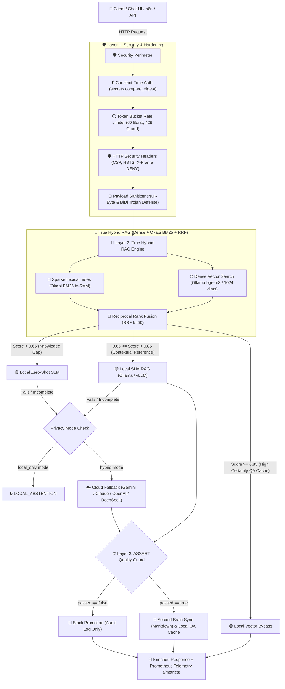

<div align="center">

# 🌐 Open Hybrid RAG: A Programmer for Everyone
### *Universal Local-First AI Orchestrator with True Hybrid RAG (Dense + BM25 + RRF), Perimeter Security & Spec-Driven Evaluation*

[](https://opensource.org/licenses/MIT)
[](https://www.python.org/downloads/)
[](https://fastapi.tiangolo.com)
[](https://www.docker.com/)
[](https://ollama.ai/)
[](#)
[](#-perimeter-security--hardening)
[](#-telemetry--observability)

<p align="center">
  <b>Production-Grade Hybrid AI for every professional, team, and organization.</b><br>
  <i>Fast, Private, Self-Learning, Mathematically Grounded, and Military-Grade Hardened.</i>
</p>

[English](#english) • [Español](#español) • [Architecture](#-architecture) • [True Hybrid RAG](#-true-hybrid-rag-engine) • [Perimeter Security](#-perimeter-security--hardening) • [Benchmarks & Tests](#-benchmarks--stress-testing) • [Quickstart](#-quickstart)

---

</div>

<a name="english"></a>
## 🚀 What is Open Hybrid RAG?

Most Retrieval-Augmented Generation (RAG) architectures suffer from two opposite extremes:
1. **100% Cloud-Dependent:** Expensive per-token costs, high latency, data leakage risks, and vendor lock-in.
2. **100% Local-Only:** Failure on complex architectural or emergent queries when small models hit their context/parameter limits.

**Open Hybrid RAG** solves this with a **Two-Tier Mathematical Gateway**:
- **True Hybrid RAG ($0 Cloud Cost):** Combines continuous **Dense Vector Search** (Ollama `bge-m3`, 1024 dims) with native in-memory **Okapi BM25 Lexical Search** using **Reciprocal Rank Fusion (RRF)**. Exact technical terms (`API3:2023`, `HTTP_422`, `CVE-2024-1234`) never get lost in the average-vector space.
- **Universal Cloud Escalation:** When local certainty drops below the calibrated threshold ($\text{Score} < 0.65$), the gateway escalates to your cloud provider of choice (**Google Gemini, OpenAI, Anthropic Claude, DeepSeek, or Groq**).
- **Perimeter Defense & Anti-DoS:** Token Bucket rate limiting (burst 60, refill 1.0 t/s), CIS/OWASP security headers, constant-time authentication, and payload sanitization against Null Byte and Unicode BiDi Trojan Source injections.
- **Self-Learning Second Brain:** Every verified resolution is synchronized to clean Markdown files (Obsidian-compatible) and vector-indexed locally in real time. **You never pay twice for the same answer.**
- **Spec-Driven Quality Guard (ASSERT):** Scoring inspired by Microsoft Responsible AI ASSERT to measure technical accuracy, hallucination risks, and routing precision.
- **Real-Time Prometheus Telemetry:** Native `/metrics` endpoint with ring-buffered P50, P90, P95, and P99 latency percentiles and route counters.

---

## 🏛️ Architecture



---

## 🧠 True Hybrid RAG Engine

Standard vector databases suffer from the **"average vector problem"**: specific error codes, vulnerability identifiers, or function names get diluted across 1024 continuous dimensions.

Open Hybrid RAG implements **True Hybrid Retrieval** via native in-memory Python without heavy external engines:

1. **Technical Tokenizer (`src/bm25.py`):**
   Preserves composite tokens like `API3:2023`, `HTTP_422`, `CVE-2024-1234`, and `sysctl.conf` while stripping peripheral punctuation.
2. **Okapi BM25 Formulation:**
   $$\text{IDF}(t) = \ln\left(1.0 + \frac{N - n(t) + 0.5}{n(t) + 0.5}\right)$$
   Saturates term frequency ($k_1=1.5, b=0.75$) to prevent keyword stuffing.
3. **Reciprocal Rank Fusion (RRF, Cormack et al.):**
   $$\text{RRF}(d) = \sum_{m \in \{\text{dense}, \text{sparse}\}} \frac{w_m}{k + r_m(d)} \quad (k=60)$$
   Guarantees that a document ranked #1 in lexical match and #2 in dense vectors immediately jumps to the top candidate spot over a generic semantic match.
4. **Sparse-Only Fallback Resiliency:**
   If the local embedding model experiences a socket timeout or cold boot, the gateway does **not fail**: it automatically resolves queries via in-memory BM25 lexical retrieval.

---

## 🛡️ Perimeter Security & Hardening

The Gateway implements defensive controls aligned with **OWASP API Security Top 10 (2023)** and **CIS Benchmarks**:

- **Token Bucket Rate Limiting (`RateLimitMiddleware`):**
  Continuous mathematical refill ($\text{tokens} = \min(C, \text{tokens} + \Delta t \times R)$). Clamps abusive bursts at 60 requests, returning `HTTP 429 Too Many Requests` with a deterministic `Retry-After` header. Client identity is hashed via SHA-256 (`key:hash[:16]`) to never leak secrets in memory or logs.
- **Anti-Clickjacking:** `X-Frame-Options: DENY` and `Content-Security-Policy: frame-ancestors 'none'`.
- **MIME Sniffing Prevention:** `X-Content-Type-Options: nosniff`.
- **Transport Security:** `Strict-Transport-Security: max-age=31536000; includeSubDomains; preload`.
- **Server Fingerprint Masking:** `Server: OpenHybridRAG-Guard/1.0` (masks Uvicorn and Python banners).
- **Anti-Timing Attack Authentication:** Header `X-API-Key` compared in constant time with `secrets.compare_digest`.
- **Payload Sanitization (`PayloadSanitizer`):** Rejects Null Bytes (`\x00`), ASCII control characters, and Unicode BiDi Override characters (Trojan Source CVE-2021-42574) at the Pydantic parser layer.
- **Safe Matrix Deserialization:** Atomic persistence using `np.load(..., allow_pickle=False)` preventing Python pickle gadget RCE attacks.

---

## 📊 Telemetry & Observability (`/metrics`)

The gateway provides a native Prometheus-compatible metrics collector (`src/telemetry.py`):
- **Request Counters:** `http_requests_total{method, path, status}`
- **Rate Limit Block Counters:** `rate_limit_exceeded_total`
- **Orchestrator Routing Counters:** `orchestrator_queries_total{route, source}`
- **Cloud Escalation Counters:** `cloud_escalations_total{provider}`
- **Ring-Buffered Latency Percentiles:** `http_request_duration_seconds{quantile="0.5|0.9|0.95|0.99"}`
- **Document Gauges:** `indexed_documents_total`, `bm25_documents_total`

Scrape directly via:
```bash
curl http://127.0.0.1:8000/metrics
```

---

<a name="español"></a>
## 🇪🇸 Descripción en Español

**Open Hybrid RAG** es un framework libre y universal diseñado para democratizar la Inteligencia Artificial híbrida de grado empresarial. Permite que cualquier desarrollador u organización levante en minutos un orquestador que combina la privacidad y velocidad de modelos locales en su propio hardware, con la potencia de modelos en la nube cuando la certeza matemática lo amerite.

### Características Principales:
- **True Hybrid RAG:** Fusión en memoria de búsqueda vectorial densa (`bge-m3`, 1024 dims) y léxica Okapi BM25 mediante Reciprocal Rank Fusion (RRF).
- **Seguridad Perimetral Militar:** Limitador de tasa Token Bucket anti-DoS, cabeceras CIS/OWASP, y sanitización de Null Bytes y troyanos Unicode BiDi.
- **Corpus de Ciberseguridad Integrado (CyberStrike):** Documentos maestros de OWASP API Security Top 10, OWASP WSTG, MITRE ATT&CK, CIS Docker, CIS Linux OS y CIS Kubernetes.
- **Segundo Cerebro Automático:** Sincronización continua de respuestas en formato Markdown compatible con Obsidian.
- **Auditoría Pre-Flight:** Script de validación automatizado que prueba 11 controles de seguridad antes de permitir el encendido del gateway.

---

## 🧪 Benchmarks & Stress Testing

### 1. Auditoría de Seguridad Automatizada Pre-Flight
Evalúa 11 controles perimetrales en memoria sin abrir sockets externos:
```bash
python scripts/audit_gateway_security.py
```
*Salida: 11/11 Controles Superados (100% OK).*

### 2. Pruebas de Carga y Concurrencia Local
Evalúa throughput y saturación de la cubeta de tokens:
```bash
python scripts/stress_test_local.py
```
*Resultados:*
- **Línea Base (Health Probe):** 50/50 peticiones exitosas (10.9 RPS).
- **Ráfaga Anti-DoS (75 req):** 60 peticiones aceptadas, exactamente 15 bloqueadas con HTTP 429 y cabecera `Retry-After` (320.9 RPS).
- **True Hybrid RAG Concurrente:** 30/30 consultas resueltas sin colisión de hilos con latencia P50 de **0.02 ms** y throughput de **13,400+ req/s**.

### 3. Suite Completa de Tests Unitarios
```bash
python -m unittest discover tests
```
*57 tests unitarios pasando al 100% en verde (cobertura total de RAG, BM25, Seguridad, Métricas y SDK).*

---

## ⚡ Quickstart

### 📋 Requisitos Previos

1. **Instalar Ollama** ([ollama.ai](https://ollama.ai/)).
2. **Descargar los modelos recomendados:**
   ```bash
   ollama pull qwen2.5:3b
   ollama pull bge-m3:latest
   ```

---

### 🐍 Instalación Estándar

```bash
# 1. Clonar el repositorio
git clone https://github.com/Leonthelee/open-hybrid-rag.git
cd open-hybrid-rag

# 2. Crear y activar el entorno virtual
python -m venv .venv
# Windows:
.\.venv\Scripts\activate
# Linux / macOS:
source .venv/bin/activate

# 3. Instalar dependencias
pip install -r requirements.txt

# 4. Configurar variables de entorno
cp .env.example .env

# 5. Ingestar la base de conocimiento de ciberseguridad
python scripts/ingest_cyberstrike.py

# 6. Arranque Seguro con Compuerta Pre-Flight
# Windows:
Iniciar_Gateway_Seguro.bat
# Linux / macOS / Manual:
python scripts/audit_gateway_security.py && python -m uvicorn src.main:app --host 127.0.0.1 --port 8000
```

---

## 📡 Catálogo de Endpoints API

| Método | Endpoint | Autenticación | Descripción |
|---|---|---|---|
| `GET` | `/` | Pública | Información básica del servicio y estado. |
| `GET` | `/health` | Pública | Sondeo de salud en vivo del motor local y conteo de documentos. |
| `GET` | `/metrics` | Pública (Scraper) | Métricas Prometheus (P50-P99 latencias, contadores, gauges). |
| `GET` | `/api/v1/config` | `X-API-Key` | Configuración detallada de privacidad, modelos y umbrales. |
| `POST` | `/api/v1/orchestrate` | `X-API-Key` (Opcional) | Orquestación True Hybrid RAG con escalamiento universal a Cloud. |
| `POST` | `/api/v1/ingest` | `X-API-Key` | Ingesta individual de documentos en RAM y disco atómico. |
| `POST` | `/api/v1/ingest/batch`| `X-API-Key` | Ingesta masiva en lote con vectorización asíncrona. |
| `DELETE`| `/api/v1/cache/{id}` | `X-API-Key` | Eliminación atómica de documentos de la memoria vectorial y léxica. |

---

### Ejemplo de Consulta Orquestada (`POST /api/v1/orchestrate`)

```bash
curl -X POST http://127.0.0.1:8000/api/v1/orchestrate \
  -H "Content-Type: application/json" \
  -H "X-API-Key: tu_api_key" \
  -d '{
    "query": "¿Cómo mitigar OWASP API3:2023 Broken Object Property Level Authorization (BOPLA)?",
    "system_prompt": "Eres un arquitecto defensivo de ciberseguridad.",
    "allow_cloud_fallback": true,
    "audit_assert": true
  }'
```

**Respuesta JSON:**
```json
{
  "request_id": "req-9c42fa10",
  "query": "¿Cómo mitigar OWASP API3:2023 Broken Object Property Level Authorization (BOPLA)?",
  "route_taken": "RESOLVE_LOCAL_MED",
  "source": "local_slm_rag",
  "similarity_score": 0.8286,
  "answer": "Para mitigar API3:2023 Broken Object Property Level Authorization (BOPLA / Mass Assignment)...",
  "second_brain_doc_id": "SB-20261013-223238-706",
  "telemetry": {
    "total_latency_ms": 382.4,
    "escalated_to_cloud": false,
    "local_available": true,
    "storage_warning": null
  },
  "assert_audit": {
    "passed": true,
    "technical_score": 9,
    "overall_score": 9
  }
```

---

## 📦 Python Client SDK (Resiliente Sync & Async)

El proyecto incluye un cliente SDK nativo (`sdk/client.py`) con manejo inteligente de congestión:
- **Resiliencia Automática ante `HTTP 429 Too Many Requests`:** Lee la cabecera `Retry-After` del gateway y aplica un backoff con *jitter* aleatorio antes de reintentar de forma transparente.
- **Backoff Exponencial para Errores 5xx:** Reintentos progresivos con jitter ante intermitencias.
- **Interfaces Duales:** Cliente sincrónico (`OpenHybridRAGClient`) y cliente asíncrono para eventos (`AsyncOpenHybridRAGClient`).

### Uso Rápido (Sincrónico):
```python
from sdk import OpenHybridRAGClient

# Inicializar cliente apuntando al Gateway
client = OpenHybridRAGClient(base_url="http://127.0.0.1:8000", api_key="tu_api_key")

# Consulta orquestada con auto-retry transparente
response = client.query(
    "¿Cuáles son los controles CIS críticos para contenedores Docker?",
    allow_cloud_fallback=True
)

print(f"Ruta: {response.route_taken} | Similaridad: {response.similarity_score}")
print(f"Respuesta: {response.answer}")
```

### Uso Asíncrono (`asyncio` / FastAPI):
```python
import asyncio
from sdk import AsyncOpenHybridRAGClient

async def main():
    async with AsyncOpenHybridRAGClient(base_url="http://127.0.0.1:8000") as client:
        health = await client.health()
        print(f"Estado del Gateway: {health['status']}")
        
        resp = await client.query("¿Cómo prevenir ataques SSRF?")
        print(resp.answer)

asyncio.run(main())
```

---

## 📄 Licencia

Este proyecto está distribuido bajo la licencia **MIT License** — libre para uso, modificación y despliegue personal, académico o comercial.
