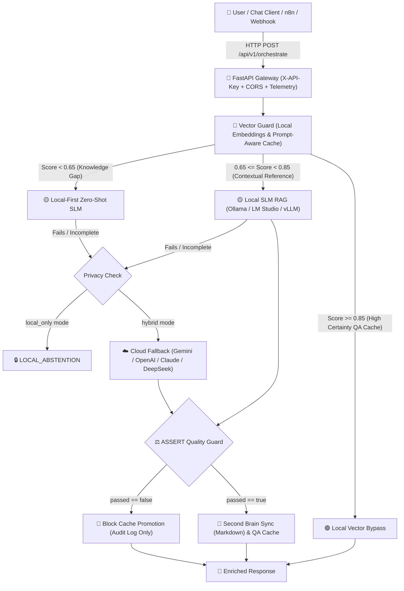

<div align="center">

# 🌐 Open Hybrid RAG: A Programmer for Everyone
### *Universal Local-First AI Orchestrator with Multi-Cloud Fallback & Spec-Driven Evaluation*

[](https://opensource.org/licenses/MIT)
[](https://www.python.org/downloads/)
[](https://fastapi.tiangolo.com)
[](https://www.docker.com/)
[](https://ollama.ai/)
[](#)
[](https://github.com/responsibleai/ASSERT)

<p align="center">
  <b>Production-Grade Hybrid AI for every professional, team, and organization.</b><br>
  <i>Fast, Private, Self-Learning, and Grounded in Mathematical Routing.</i>
</p>

[English](#english) • [Español](#español) • [Architecture](#-architecture) • [50-Question Benchmark](#-50-question-calibration-benchmark) • [Quickstart](#-quickstart)

---

</div>

<a name="english"></a>
## 🚀 What is Open Hybrid RAG?

Most Retrieval-Augmented Generation (RAG) implementations are either **100% cloud-dependent** (costly per token, high latency, data leakage risks) or **100% local-only** (failing at complex architectural problems when local models reach their context and capacity limits).

**Open Hybrid RAG** solves this with a **Two-Tier Mathematical Gateway**:
1. **Local-First ($0 Cloud Cost):** High-density vector embeddings with instant hot-cache bypass and local LLM inference (Ollama, LM Studio, vLLM, llama.cpp).
2. **Universal Cloud Escalation:** When local certainty drops below the mathematical threshold ($\text{Score} < 0.65$), the gateway escalates to your cloud model of choice (**Google Gemini, OpenAI, Claude, DeepSeek, or Groq**).
3. **Continuous Second-Brain Loop:** Every verified resolution is automatically formatted into clean Markdown (Obsidian-compatible) and vector-indexed locally in real time. **The system avoids paying for the same answer twice.**
4. **Spec-Driven Quality Guard (ASSERT):** Built-in automated scoring inspired by Microsoft Responsible AI ASSERT to measure technical accuracy, clarity, and routing precision.

---

## 🏛️ Architecture



---

## 💻 Hardware Requirements & Tiered Scalability

Because heavy reasoning can be offloaded to universal cloud fallbacks when needed, your local machine only needs to handle fast routing, embeddings, and lightweight quantized models (SLMs):

| Hardware Tier | Target Machine | Local Model Setup | Local Embeddings | Cloud Role |
|---|---|---|---|---|
| **Tier 1: Minimalist (CPU-Only / Everyday PC)** | Standard Laptop / Office PC (8GB - 16GB RAM, No GPU) | `qwen2.5:1.5b` or `llama3.2:1b` (CPU int8, ~1.2GB RAM) | `nomic-embed-text` (274 MB) or `bge-m3` | Handles standard tasks; escalates complex cases to Cloud. |
| **Tier 2: Workstation (Entry GPU / Mac M-Series)** | Dev PC / Mac M1-M4 / NVIDIA Quadro (4GB - 8GB VRAM) | `qwen2.5:3b` or `llama3.2:3b` (GPU/CPU, ~2GB VRAM) | `qwen3-embedding:8b` (4096-dim) | Handles local queries with sub-second latency. |
| **Tier 3: Powerhouse (Dedicated AI Rig)** | High-End GPU Rig (16GB - 24GB+ VRAM) | `qwen2.5:14b` / `deepseek-coder` / `llama3.3:70b` | `qwen3-embedding:8b` or local vLLM | High local resolution; cloud used as backup/auditor. |

---

<a name="español"></a>
## 🇪🇸 Descripción en Español

**Open Hybrid RAG** es un framework libre y universal diseñado para democratizar la Inteligencia Artificial híbrida de alto nivel. Permite que cualquier desarrollador o profesional levante en minutos un orquestador que combina la privacidad y velocidad de modelos locales en su hardware, con la potencia de modelos en la nube.

### Principios Fundamentales:
- **Un Programador para Todos:** Diseñado con Clean Architecture para que cualquier área (TI, Infraestructura, Soporte, Desarrollo) pueda construir asistentes confiables.
- **Agnóstico y Universal:** Funciona con Ollama, LM Studio, vLLM, y permite alternar en la nube entre Gemini, OpenAI, Claude, Groq o DeepSeek con un solo cambio en `.env`.
- **Auto-Aprendizaje Continuo:** Cada duda resuelta se guarda en notas Markdown en tu Segundo Cerebro (Obsidian) y se indexa vectorialmente de forma atómica.

---

## 🧪 50-Question Calibration Benchmark

Included in this repository is a dataset of **50 Real-World Technical Assessment Questions** (`benchmark/50_technical_benchmark.json`) with ground truth reference summaries and keyword coverage:

- **Category 1:** Networks, Protocols & Telecom (BGP, OSPF, MTU/MSS, IPsec, 802.1Q).
- **Category 2:** Operating Systems, Linux & Windows Server (Systemd, Active Directory, Print Spooler, LVM).
- **Category 3:** Containers, Docker & Kubernetes (Multi-stage builds, OOMKilled, Ingress, Pod debugging).
- **Category 4:** Databases & Backend Architecture (ACID, Deadlocks, B-Tree index optimization, Cache-Aside).
- **Category 5:** Artificial Intelligence, RAG & LLMOps (Cosine similarity, Chunking, Re-ranking, Quantization, ASSERT).

Run the full benchmark:
```bash
# Modo frío (Cold run)
python benchmark/run_benchmark.py --mode cold

# Modo comparativo (Cold vs Warm con concurrencia controlada)
python benchmark/run_benchmark.py --mode all --concurrency 4
```

---

## ⚡ Step-by-Step Installation Guide

### 📋 Prerequisites

1. **Local LLM Engine (Ollama / LM Studio / vLLM):**
   - Download and install [Ollama](https://ollama.ai/).
   - Pull the recommended lightweight models in your terminal:
     ```bash
     ollama pull qwen2.5:3b
     ollama pull qwen3-embedding:8b
     ```

---

### 🐍 Method 1: Standard Python (No Docker required)

```bash
# 1. Clone the repository
git clone https://github.com/Leonthelee/open-hybrid-rag.git
cd open-hybrid-rag

# 2. Create and activate a virtual environment
python -m venv venv
# Windows:
.\venv\Scripts\activate
# Linux / macOS:
source venv/bin/activate

# 3. Install dependencies
pip install -r requirements.txt

# 4. Copy and configure your .env
cp .env.example .env

# 5. Start the Gateway
python -m uvicorn src.main:app --host 127.0.0.1 --port 8000
```

---

### 🐳 Method 2: Docker Compose

```bash
git clone https://github.com/Leonthelee/open-hybrid-rag.git
cd open-hybrid-rag
cp .env.example .env

# Launch with Docker Compose (runs as non-root user appuser)
docker compose up -d
```

---

### ✅ Verify Installation
```bash
curl http://localhost:8000/
```
Expected output:
```json
{
  "status": "online",
  "service": "Open Hybrid RAG Gateway",
  "privacy_mode": "hybrid",
  "local_engine": {
    "type": "ollama",
    "llm_model": "qwen2.5:3b",
    "embed_model": "qwen3-embedding:8b",
    "endpoint": "http://127.0.0.1:11434/api/chat"
  },
  "cloud_fallback": {
    "provider": "gemini",
    "model": "gemini-2.0-flash",
    "configured": true
  },
  "vector_index": {
    "indexed_documents": 0,
    "expected_dimensions": null,
    "storage_path": "./knowledge_base/index.npz"
  }
}
```

---

## 📡 API Endpoints

### 1. Orchestrated Query (`POST /api/v1/orchestrate`)
```bash
curl -X POST http://localhost:8000/api/v1/orchestrate \
  -H "Content-Type: application/json" \
  -H "X-API-Key: your_key_if_configured" \
  -d '{
    "query": "¿Cómo diagnosticar un Deadlock en PostgreSQL?",
    "system_prompt": "Eres un arquitecto senior de base de datos.",
    "allow_cloud_fallback": true,
    "audit_assert": true
  }'
```

### 2. Document Ingestion (`POST /api/v1/ingest`)
```bash
curl -X POST http://localhost:8000/api/v1/ingest \
  -H "Content-Type: application/json" \
  -H "X-API-Key: your_key_if_configured" \
  -d '{
    "doc_id": "GUIDE-BGP-01",
    "text": "Configuración estándar de BGP Flapping con route dampening...",
    "doc_type": "document",
    "ttl_seconds": 86400
  }'
```

### 3. Cache Eviction (`DELETE /api/v1/cache/{doc_id}`)
```bash
curl -X DELETE http://localhost:8000/api/v1/cache/GUIDE-BGP-01 \
  -H "X-API-Key: your_key_if_configured"
```

---

## ⚡ Integrations & Utilities

### 🔄 1-Click n8n Workflow
Included in `integrations/n8n/n8n_workflow_open_hybrid_rag.json` is a template for n8n:
- **Webhook Input:** Receives queries from chat interfaces or bots.
- **Decision Routing:** Handles local vs cloud responses seamlessly.

### 📂 Hot Knowledge Sync Scripts
Index entire directories of Markdown notes (Obsidian vaults, knowledge bases):
- **Windows (PowerShell):** `.\scripts\sync_brain.ps1 -FolderPath "C:\Your\Notes" -ApiKey "your_key"`
- **Linux / macOS (Bash):** `./scripts/sync_brain.sh /path/to/notes`

---

## 📄 License

This project is licensed under the **MIT License** — feel free to use, modify, and distribute in personal, academic, or commercial projects.
