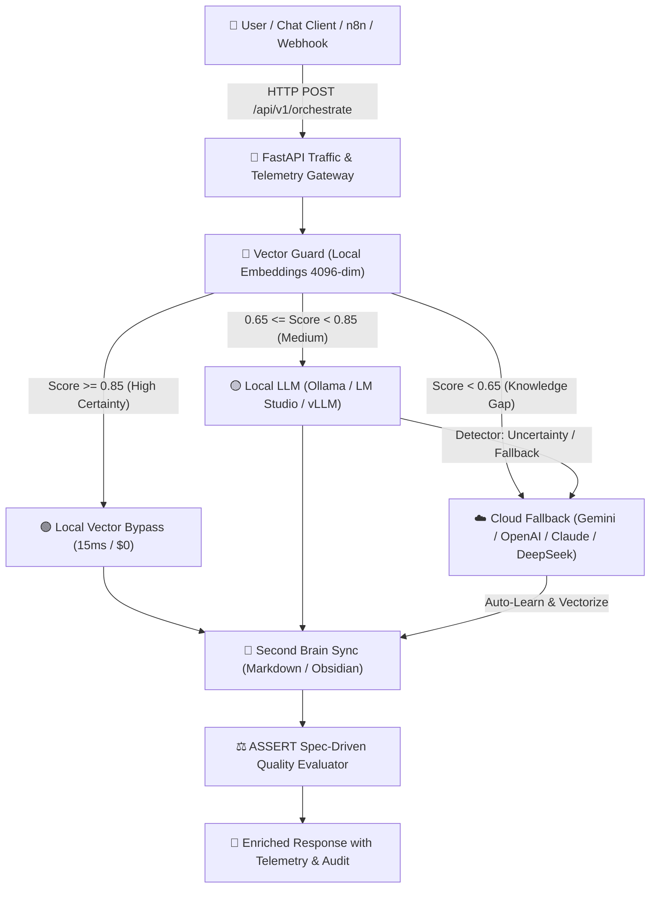

<div align="center">

# 🌐 Open Hybrid RAG: A Programmer for Everyone
### *Universal Local-First AI Orchestrator with Multi-Cloud Fallback & Spec-Driven Evaluation*

[](https://opensource.org/licenses/MIT)
[](https://www.python.org/downloads/)
[](https://fastapi.tiangolo.com)
[](https://www.docker.com/)
[](https://ollama.ai/)
[](#)
[](https://github.com/responsibleai/ASSERT)

<p align="center">
  <b>Democratizing Production-Grade Hybrid AI for every professional, team, and organization.</b><br>
  <i>Fast, Private, Self-Learning, and Grounded in Mathematical Certainty.</i>
</p>

[English](#english) • [Español](#español) • [Architecture](#-architecture) • [50-Question Benchmark](#-50-question-calibration-benchmark) • [Quickstart](#-quickstart)

---

</div>

<a name="english"></a>
## 🚀 What is Open Hybrid RAG?

Most Retrieval-Augmented Generation (RAG) implementations are either **100% cloud-dependent** (costly per token, high latency, data leakage risks) or **100% local-only** (failing at complex architectural problems when local models reach their context and capacity limits).

**Open Hybrid RAG** solves this with a **Two-Tier Mathematical Gateway**:
1. **Local-First (0ms Cloud / $0 Cost):** High-density vector embeddings with instant hot-cache bypass and local LLM inference (Ollama, LM Studio, vLLM, llama.cpp).
2. **Universal Cloud Escalation:** When local certainty drops below the mathematical threshold ($\text{Score} < 0.75$), the gateway silently escalates to your cloud model of choice (**Google Gemini, OpenAI, Claude, DeepSeek, or Groq**).
3. **Continuous Second-Brain Loop:** Every cloud resolution is automatically formatted into clean Markdown (Obsidian-compatible) and vector-indexed locally in real time. **The system never pays for the same answer twice.**
4. **Spec-Driven Quality Guard (ASSERT):** Built-in automated scoring inspired by Microsoft Responsible AI ASSERT to measure technical accuracy, clarity, and routing precision.

---

## 🏛️ Architecture



---

## ✨ Core Highlights

| Feature | Traditional RAG | Open Hybrid RAG |
|---|---|---|
| **Latency** | 800ms - 2500ms | **15ms** (Hot cache) / **300ms** (Local) |
| **API Costs** | High ($ per token) | **~85% Cost Reduction** (Local First) |
| **Data Privacy** | Everything leaves to cloud | **Local First**, private data stays local |
| **Model Freedom** | Vendor lock-in | **Agnostic (Ollama, vLLM, Gemini, OpenAI, Claude)** |
| **Learning Loop** | Static knowledge base | **Self-improving second brain (Markdown)** |
| **Quality Audit** | Vibe-checking / manual | **Automated ASSERT Spec-Driven Scoring** |

---

## 💻 Hardware Requirements & Tiered Scalability (No $2,000 GPU Required)

Most local AI articles claim you need an expensive NVIDIA RTX 4080/4090 with 24GB VRAM. **Open Hybrid RAG was engineered specifically to break the VRAM barrier.**

Because heavy architectural reasoning is offloaded to the universal cloud fallback when needed, your local machine only needs to handle fast routing, embeddings, and lightweight quantized models (SLMs). It adapts smoothly across 3 hardware tiers:

| Hardware Tier | Target Machine | Local Model Setup | Local Embeddings | Cloud Role |
|---|---|---|---|---|
| **Tier 1: Minimalist (CPU-Only / Everyday PC)** | Standard Laptop / Office PC (8GB - 16GB RAM, No GPU) | `qwen2.5:1.5b` or `llama3.2:1b` (CPU int8, ~1.2GB RAM) | `nomic-embed-text` (274 MB) or `bge-m3` | Handles standard tasks; escalates complex cases to Cloud. |
| **Tier 2: Workstation (Entry GPU / Mac M-Series)** | Dev PC / Mac M1-M4 / NVIDIA Quadro (4GB - 8GB VRAM) | `qwen2.5:3b` or `llama3.2:3b` (GPU/CPU, ~2GB VRAM) | `qwen3-embedding:8b` (4096-dim) | Handles 85% of queries locally with sub-second latency. |
| **Tier 3: Powerhouse (Dedicated AI Rig)** | High-End GPU Rig (16GB - 24GB+ VRAM) | `qwen2.5:14b` / `deepseek-coder` / `llama3.3:70b` | `qwen3-embedding:8b` or local vLLM | 95%+ Local resolution; cloud used as backup/auditor. |

### 🚀 Why It Runs Fast on Modest Hardware:
1. **NumPy Vector Guard:** Cosine similarity calculation takes less than **1 millisecond** on pure CPU.
2. **Zero CUDA Lock-In:** Runs natively on CPU (`int8`), Apple Metal, or entry-level GPUs without complex drivers.
3. **Elastic Fallback:** If your local machine runs low on RAM or encounters a knowledge gap, the gateway automatically escalates to the cloud instead of crashing or freezing your OS.

---

<a name="español"></a>
## 🇪🇸 Descripción en Español

**Open Hybrid RAG** es un framework libre y universal diseñado para democratizar la Inteligencia Artificial híbrida de alto nivel. Permite que cualquier desarrollador o profesional levante en minutos un orquestador que combina la privacidad y velocidad de modelos locales en su hardware, con la potencia de modelos en la nube.

### Principios Fundamentales:
- **Un Programador para Todos:** Diseñado con Clean Architecture para que cualquier área (TI, Salud, Educación, Finanzas, Legal) pueda construir asistentes con nivel de confianza de producción.
- **Agnóstico y Universal:** Funciona con Ollama, LM Studio, vLLM, y permite alternar en la nube entre Gemini, OpenAI, Claude, Groq o DeepSeek con un solo cambio en `.env`.
- **Auto-Aprendizaje Continuo:** Cada duda resuelta en la nube se guarda en notas Markdown en tu Segundo Cerebro (Obsidian) y se indexa en memoria RAM para que la próxima vez sea 100% local.

---

## 🧪 50-Question Calibration Benchmark

Included in this repository is a dataset of **50 Real-World Technical Assessment Questions** (`benchmark/50_technical_benchmark.json`) to stress-test and calibrate your RAG before moving to production:

- **Category 1:** Networks, Protocols & Telecom (BGP, OSPF, MTU/MSS, IPsec, 802.1Q).
- **Category 2:** Operating Systems, Linux & Windows Server (Systemd, Active Directory, Print Spooler, LVM).
- **Category 3:** Containers, Docker & Kubernetes (Multi-stage builds, OOMKilled, Ingress, Pod debugging).
- **Category 4:** Databases & Backend Architecture (ACID, Deadlocks, B-Tree index optimization, Cache-Aside).
- **Category 5:** Artificial Intelligence, RAG & LLMOps (Cosine similarity, Chunking, Re-ranking, Quantization, ASSERT).

Run the full benchmark in one command:
```bash
python benchmark/run_benchmark.py
```

---

## ⚡ Step-by-Step Installation Guide (Guía Paso a Paso)

You can run Open Hybrid RAG in **under 2 minutes** using any of the following methods:

---

### 📋 Prerequisites (Prerrequisitos)

1. **Local LLM Engine (Ollama / LM Studio / vLLM):**
   - Download and install [Ollama](https://ollama.ai/).
   - Pull the recommended lightweight models in your terminal:
     ```bash
     ollama pull qwen2.5:3b
     ollama pull qwen3-embedding:8b
     ```
     *(Or use `ollama pull nomic-embed-text` if you have less than 8GB RAM).*

---

### 🚀 Method 1: 1-Click Launcher (Windows / Linux / macOS)

* **Windows:** Simply double-click `Iniciar_Gateway.bat` (it automatically creates the virtual environment, installs dependencies, and launches the server).
* **Linux / macOS:**
  ```bash
  chmod +x start_gateway.sh
  ./start_gateway.sh
  ```

---

### 🐍 Method 2: Standard Python (No Docker required)

```bash
# 1. Clone the repository
git clone https://github.com/your-username/open-hybrid-rag.git
cd open-hybrid-rag

# 2. Create and activate a virtual environment
python -m venv venv
# Windows:
.\venv\Scripts\activate
# Linux / macOS:
source venv/bin/activate

# 3. Install lightweight dependencies (FastAPI, NumPy, HTTPX)
pip install -r requirements.txt

# 4. Copy and configure your .env
cp .env.example .env

# 5. Start the Gateway
python -m src.main
```

---

### 🐳 Method 3: Docker Compose

```bash
# 1. Clone and configure .env
git clone https://github.com/your-username/open-hybrid-rag.git
cd open-hybrid-rag
cp .env.example .env

# 2. Launch with Docker Compose
docker compose up -d
```

---

### ✅ Verify Installation
Open your browser or run curl to verify that the gateway is live:
```bash
curl http://localhost:8000/
```
Expected output:
```json
{
  "status": "online",
  "service": "Open Hybrid RAG Gateway",
  "local_llm": "qwen2.5:3b",
  "local_embed": "qwen3-embedding:8b",
  "cloud_llm": "gemini-2.0-flash",
  "indexed_vectors": 0
}
```

---

## 📡 API Usage

### Orchestrated Query (`POST /api/v1/orchestrate`)
```bash
curl -X POST http://localhost:8000/api/v1/orchestrate \
  -H "Content-Type: application/json" \
  -d '{
    "query": "How to resolve BGP flapping on an edge router?",
    "audit_assert": true
  }'
```

#### JSON Response:
```json
{
  "request_id": "req-9b82f1c4",
  "query": "How to resolve BGP flapping on an edge router?",
  "route_taken": "RESOLVE_LOCAL_HIGH",
  "source": "local_vector_cache_bypass",
  "similarity_score": 0.9412,
  "answer": "To mitigate BGP flapping, configure BGP route dampening and adjust keepalive/hold-time timers...",
  "second_brain_doc_id": "KB-20261010-154500",
  "telemetry": {
    "total_latency_ms": 18.4,
    "escalated_to_cloud": false
  },
  "assert_audit": {
    "technical_score": 9,
    "clarity_score": 10,
    "route_score": 10,
    "overall_score": 9.6,
    "passed": true,
    "feedback": "Clear, technically accurate command steps with zero hallucinations."
  }
}
```

---

## ⚡ Integrations & Utilities

### 🔄 1-Click n8n Workflow
Included in `integrations/n8n/n8n_workflow_open_hybrid_rag.json` is a production-ready template for n8n:
- **Webhook Input:** Receives queries from any external frontend, Telegram bot, or API.
- **Smart Decision Node:** Segments responses based on whether the query was resolved locally (0ms) or escalated to the cloud.
- **Import:** Open n8n ➔ `Import from File` ➔ Select `integrations/n8n/n8n_workflow_open_hybrid_rag.json`.

### 📂 Hot Knowledge Sync Scripts
Easily index entire directories of Markdown notes (e.g. Obsidian Vaults, docs) into the running gateway:
- **Windows (PowerShell):** `.\scripts\sync_brain.ps1 -FolderPath "C:\Your\Notes"`
- **Linux / macOS (Bash):** `./scripts/sync_brain.sh /path/to/notes`

---

## 🤝 Open Source Ecosystem & Acknowledgments

- **Local AI Foundations:** Ollama, Qwen Team (Alibaba Cloud), vLLM, llama.cpp, and LM Studio.
- **Cloud Intelligence:** Google Gemini, OpenAI, Anthropic, DeepSeek, and Groq.
- **Evaluation Engineering:** Microsoft Responsible AI Team for the **ASSERT** methodology.

---

## 📄 License

This project is licensed under the **MIT License** — feel free to use, modify, and distribute in personal, academic, or commercial projects.
